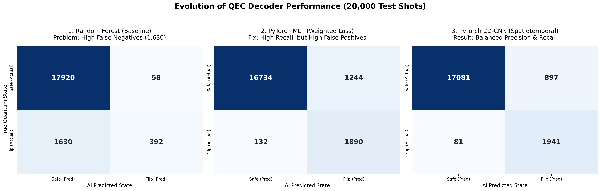
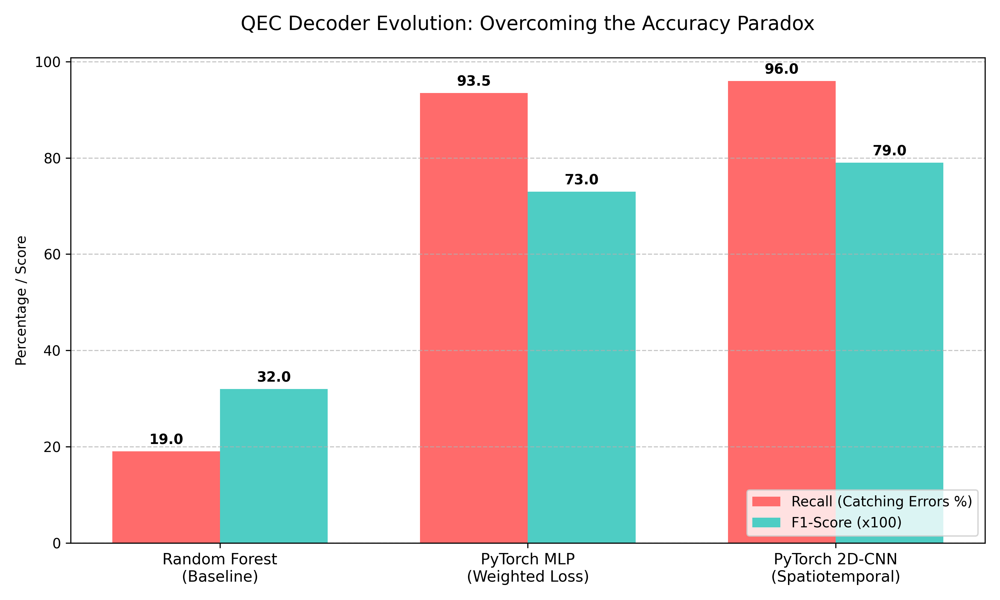

# Machine Learning Decoders for Quantum Error Correction (Repetition Code)

A machine-learning pipeline that decodes syndrome measurements from a noisy **distance-5 quantum repetition code** and predicts whether the logical qubit was flipped. Syndrome data is simulated with [Stim](https://github.com/quantumlib/Stim), and three decoders (Random Forest, MLP, 2D-CNN) are compared on an imbalanced, circuit-level-noise dataset.

## Problem

In quantum error correction (QEC), one logical qubit is encoded across several physical qubits. The data qubits cannot be measured directly without destroying the quantum state, so **ancilla qubits** repeatedly measure parity checks (stabilizers). The resulting bit patterns, called **syndromes** (or *detection events*), are all a **decoder** gets to see. From them it must infer whether the logical information has been flipped.

This project treats decoding as **binary classification**:

- **Input (X):** 24 detection-event bits per shot
- **Target (y):** 1 if the logical observable flipped, 0 otherwise

At a 3% physical error rate, logical flips occur in only ~10% of shots. That class imbalance is the main ML challenge here.

## Pipeline

```
Stim circuit (repetition_code:memory, d=5, 5 rounds, circuit-level noise)
        │  sample 100,000 shots
        ▼
Detection events X (100000 × 24)  +  logical-flip labels y (100000,)
        │  80/20 stratified split (random_state=42)
        ▼
Random Forest  →  MLP (weighted loss)  →  2D-CNN (weighted loss)
        │
        ▼
Confusion matrices, precision / recall / F1, logical error rate
```

## Dataset

| Setting | Value |
|---|---|
| Code | Repetition code, distance 5 (5 data qubits, 4 ancillas) |
| Rounds | 5 stabilizer-measurement rounds |
| Noise | Stim circuit-level noise: `after_clifford_depolarization=0.03`, `before_measure_flip_probability=0.03` |
| Shots | 100,000 |
| Features | 24 detector bits = 6 detector layers × 4 detectors (5 measurement rounds + 1 final layer comparing the last data-qubit readout with the last ancilla round) |
| Label | Logical observable flipped (1) or not (0) |
| Class balance | ~10% positive (about 9 : 1 negative-to-positive) |
| Split | 80% train / 20% test, stratified (20,000 test shots, 2,022 positives) |

> Labels come from the simulator, which can see the final logical state. A real device never measures data qubits mid-computation, so at deployment the decoder only receives the syndrome bits.

## Models

1. **Random Forest (baseline).** `n_estimators=50`, `max_depth=10`, on the flat 24-bit vector.
2. **MLP.** 24 → 64 → 32 → 1 with ReLU and dropout, trained with `BCEWithLogitsLoss(pos_weight ≈ 9)` (Adam, lr 1e-3, batch size 256, 15 epochs).
3. **2D-CNN.** The 24 bits are reshaped to a `1 × 6 × 4` grid (detector layers × detectors). Two 3×3 conv layers (16 and 32 channels) feed a 64-unit dense layer and one output logit. Same weighted loss and training setup as the MLP.

The reshaping preserves the time ordering and the neighbor structure of the detectors, so convolutional filters can pick up errors that persist across rounds or show up on adjacent detectors.

## Results (20,000 held-out test shots)

| Model | Accuracy | Precision (flip) | Recall (flip) | F1 (flip) | Missed flips (FN) | False alarms (FP) | Logical error rate* |
|---|---|---|---|---|---|---|---|
| Always predict "no flip" | 89.9% | – | 0% | – | 2,022 | 0 | 10.1% |
| Random Forest | 91.56% | 87.1% | 19.4% | 0.32 | 1,630 | 58 | 8.4% |
| MLP (weighted loss) | 93.12% | 60.3% | 93.5% | 0.73 | 132 | 1,244 | 6.9% |
| 2D-CNN (weighted loss) | 95.11% | 68.4% | 96.0% | 0.80 | 81 | 897 | 4.9% |
| MWPM (PyMatching, classical baseline) | 99.31% | 96.2% | 97.0% | 0.97 | 61 | 77 | **0.69%** |

\*Logical error rate = (FP + FN) / test shots, the fraction of shots where the decoder's predicted logical flip is wrong. Applying a wrong correction causes a logical error whether it is a missed flip or a false alarm.




### Key takeaways

- **Accuracy is misleading on imbalanced data.** A model that always predicts "no flip" scores ~90%, so accuracy and logical error rate matter more than raw accuracy here.
- **Weighting the loss recovered recall but cost precision.** The weighted MLP and CNN catch ~93-96% of flips, but produce many false alarms (precision 60-68%), and every false alarm is also a logical error.
- **Spatiotemporal structure helped.** Reshaping to a 6x4 grid cut the logical error rate from 6.9% (MLP) to 4.9% (CNN).
- **The classical MWPM decoder is much better on this code and noise (0.69% vs 4.9%).** Its recall is similar to the CNN's, so the gap is almost entirely false alarms. This suggests the weighted loss, not model capacity alone, is the main limitation. This is being tested next with an unweighted model.

## Limitations

- **Single noise point.** All results are at a 3% physical error rate. No threshold or error-rate sweep has been run yet.
- **Single run.** Results come from one train/test split and one seed, with no confidence intervals.
- **The neural decoders do not match MWPM.** On this repetition code with independent circuit noise, MWPM is near-optimal and clearly outperforms all three ML models. ML decoders are expected to be most useful with correlated or hardware-specific noise, which is not tested here.
- **Repetition code only.** It corrects bit-flip errors only. It is not a surface code and has no 2D lattice, so the "spatial" axis is a 1D row of 4 detectors.
- **Weighted loss is probably hurting decoding quality.** Minimizing logical error rate calls for a calibrated probability thresholded at 0.5 (a plain BCE loss). Weighting inflates false alarms. An unweighted comparison is the next experiment.
- **Simulated noise only.** No real-hardware data was used.

## Roadmap

- [x] Add a PyMatching (MWPM) baseline on the same test shots (`mwpm_baseline.py`)
- [ ] Train an unweighted CNN and tune the decision threshold to minimize logical error rate
- [ ] Sweep the physical error rate (e.g. 0.1% to 10%) and plot logical vs. physical error rate
- [ ] Vary code distance (3, 5, 7) and report scaling
- [ ] Multiple seeds with mean ± std
- [ ] Extend to the rotated surface code (`surface_code:rotated_memory_z`) with a true 2D input

## Repository structure

```
├── phase1_bitflip.ipynb          # 3-qubit bit-flip code in Qiskit (learning exercise)
├── phase1_phaseflip.ipynb        # 3-qubit phase-flip code in Qiskit (learning exercise)
├── phase2_qiskit_gen.py          # 1,000-shot Qiskit noisy dataset (learning exercise)
├── phase2_stim_generator.py      # Stim dataset generation (main dataset)
├── phase3_rf_decoder.py          # Random Forest baseline
├── phase3_mlp_decoder.py         # PyTorch MLP with weighted loss
├── phase3_cnn_decoder.py         # PyTorch 2D-CNN with weighted loss
├── mwpm_baseline.py              # PyMatching (MWPM) classical baseline on the same test split
├── phase4_visualizations.py      # Evolution chart
├── phase4_matrix_comparison.py   # Triple confusion-matrix figure
└── data/                         # Generated .npy files (not tracked)
```

## How to run

```bash
conda create -n qec_ml python=3.10
conda activate qec_ml
pip install stim pymatching numpy scikit-learn torch matplotlib seaborn qiskit qiskit-aer

python phase2_stim_generator.py     # creates data/X_stim_syndromes.npy and y_stim_labels.npy
python phase3_rf_decoder.py         # Random Forest baseline
python phase3_mlp_decoder.py        # MLP
python phase3_cnn_decoder.py        # CNN
python mwpm_baseline.py             # classical MWPM baseline (pip install pymatching)
python phase4_matrix_comparison.py  # comparison figure
```

The confusion-matrix figures use values copied from the console output of the three decoder scripts. Re-running with different random state or fresh data will change them slightly.

## Tech stack

Python, Stim, PyTorch, scikit-learn, NumPy, Matplotlib, Seaborn, Qiskit (introductory circuits only)

## Concepts covered

Stabilizer measurements and syndrome extraction, bit-flip and phase-flip codes, circuit-level noise, detection events and logical observables, class imbalance and weighted BCE loss, precision/recall/F1 and confusion matrices, convolutional networks on spatiotemporal data.